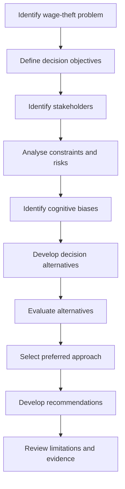

# judgment-and-decision-making
wage-theft-international-students
# Decision Analysis: Wage Theft Among International Students in Australia

## Overview

This case study examines wage theft and underpayment vulnerabilities affecting international students in Australia through a judgment and decision-making perspective.

The project explores the relationship between employment conditions, reported wage-theft cases, stakeholder behaviour, cognitive biases and potential mitigation strategies. It considers how decision-making processes and behavioural factors may influence employer practices and the choices available to international students experiencing underpayment.

This case study was developed as part of the **Judgment & Decision Making (49001)** subject at the University of Technology Sydney (UTS).

## Problem Context

International students may face employment-related vulnerabilities arising from factors such as limited awareness of workplace rights, financial pressures, dependence on employment, information asymmetry and perceived risks associated with challenging employers.

Wage underpayment can involve complex decisions for multiple stakeholders, including employees, employers, regulatory bodies, educational institutions and advocacy organisations.

The case study examines the issue through a decision-making lens rather than treating it solely as an employment-law problem.

## Objectives

- Examine the wage-theft issue affecting international students in Australia.
- Explore factors that may influence employer and employee decision-making.
- Examine the role of cognitive biases and behavioural considerations.
- Identify key stakeholders and their interests.
- Compare potential mitigation strategies.
- Develop a structured approach to evaluating possible interventions.

## Analytical Scope

The analysis explores the following themes:

### 1. Problem Analysis
- Wage underpayment and employment vulnerability.
- Reported wage-theft cases.
- Employment-sector considerations.
- Wage comparisons and employment conditions.

### 2. Stakeholder Analysis
Potential stakeholders considered within the case study include:

- International students.
- Employers.
- Universities and educational institutions.
- Government and regulatory agencies.
- Worker advocacy organisations.

### 3. Decision-Making and Cognitive Biases

The case study considers how decision-making behaviour, cognitive biases, incentives and information asymmetry may contribute to employment-related decisions and outcomes.

### 4. Mitigation Strategy Evaluation

Potential interventions explored include:

- Awareness and education campaigns.
- Legal support and assistance.
- Regulatory monitoring and government audits.

The interventions are considered in terms of their potential contribution to awareness, prevention, accountability and protection.

## Evidence-Based Insight — Data Availability and Enforcement

Research by Chen et al. (2024) highlights that workplace-relations law enforcement can be constrained by the availability, accessibility and quality of relevant data. The authors examine the Australian workplace-relations data ecosystem and identify shortcomings in the availability of data needed to support compliance and enforcement.

This finding is relevant to wage theft affecting international students because effective detection and enforcement depend not only on workers reporting violations, but also on the ability of regulatory bodies to access, analyse and use reliable information.

**Implications for decision-making:**

- **Information quality:** Decisions should rely on reliable, accessible and sufficiently detailed data.
- **Detection capability:** Better data collection and integration may help regulators identify patterns of noncompliance.
- **Institutional coordination:** Data-sharing arrangements may improve regulatory effectiveness.
- **Decision limitations:** When reliable data is unavailable, decision-makers must acknowledge uncertainty rather than treat illustrative statistics as empirical evidence.

**Source:** Chen et al. (2024), *Open data, workplace relations law compliance, and digital regulation*. See `references.md`.

This insight supports the project's emphasis on evidence quality, limitations and informed decision-making when evaluating potential responses to wage theft.

## Visual Analysis

## Visualisation 1 — Reported Wage-Theft Cases (Illustrative)


## Visualisation 2 — Employment Sector Distribution (Illustrative)


## Visualisation 3 — Australian National Minimum Wage Trend (2018–2022)


> **Context:** This chart presents the Australian national minimum wage hourly rate over the selected period. National minimum wage rates are a baseline and may not apply to every worker, as award rates, classifications and other employment conditions may affect applicable pay.

> **Data disclaimer:** Illustrative percentages only. These figures have not been verified against an official dataset and should not be interpreted as actual employment-sector statistics.

> **Data disclaimer:** Illustrative values only. These figures have not been verified against an official dataset and should not be interpreted as actual reported case counts.

The original assignment included visual representations of the following themes:

| Visual | Analytical focus |
|---|---|
| Reported Cases of Wage Theft (2018–2023) | Trend representation of reported cases |
| Proportion of International Students by Sector | Employment-sector distribution |
| Wage Comparison Over Time | Comparison between plotted student wages and legal minimum wage |
| Flow of Decision-Making Biases | Conceptual relationship between decisions, cognitive biases and underpayment |
| Effectiveness of Mitigation Strategies | Comparative representation of intervention effectiveness |

> Data verification note: Figures presented in the original assignment visuals will be reviewed before being used as verified statistical evidence. Where data is illustrative or hypothetical, it will be explicitly labelled as such.

## Limitations of the Visual Analysis

The visualisations included in this project serve different analytical purposes and have different data limitations.

- **Visualisation 1:** Uses illustrative values to demonstrate a potential time-series analysis of reported wage-theft cases. It does not represent verified case statistics.
- **Visualisation 2:** Uses illustrative percentages to demonstrate employment-sector distribution. It does not represent an empirically verified sector breakdown.
- **Visualisation 3:** Presents historical Australian national minimum wage baseline rates from 2018–2022. It provides wage-policy context but does not measure wage theft, underpayment, or international students' actual earnings.

Consequently, these visualisations should not be interpreted as empirical evidence of wage-theft prevalence, trends, sector-specific incidence, or causation.

A future version of this analysis could incorporate verified government datasets, survey findings, enforcement statistics, and documented worker experiences to support more robust quantitative analysis.

## Decision Analysis Approach

The case study will be developed using a structured analytical approach:

1. Define the decision problem.
2. Identify stakeholders and relevant factors.
3. Examine behavioural and cognitive considerations.
4. Identify potential intervention alternatives.
5. Establish evaluation criteria.
6. Compare alternatives.
7. Develop recommendations based on the analysis.

The specific decision frameworks and methodology will be documented as the case study is reconstructed and refined.

## Key Considerations

- Decision-making under uncertainty.
- Behavioural factors and cognitive biases.
- Stakeholder interests and competing incentives.
- Employment vulnerability and information asymmetry.
- Evaluation of intervention alternatives.
- Evidence-based recommendations.

## Repository Structure

```text
wage-theft-international-students/
├── README.md
├── references.md
└── visuals/
```

## Limitations

This portfolio case study is based on academic work originally undertaken as part of a university subject.

Statistical figures and comparative effectiveness values shown in the original visuals will be verified against their underlying sources before being presented as factual evidence. Conceptual illustrations and hypothetical values, where used, will be clearly distinguished from verified data.

The case study does not constitute legal advice.

## Academic Context

**Subject:** 49001 – Judgment & Decision Making  
**Institution:** University of Technology Sydney (UTS)  
**Project focus:** Decision analysis of wage-theft vulnerabilities affecting international students in Australia

---
## Decision-Analysis Process



This diagram illustrates the analytical process used to structure the case study. It represents the project's decision-analysis workflow, not a claim that every stage was empirically validated.

*This portfolio entry is being reconstructed and refined from the original academic work for professional portfolio presentation.*
