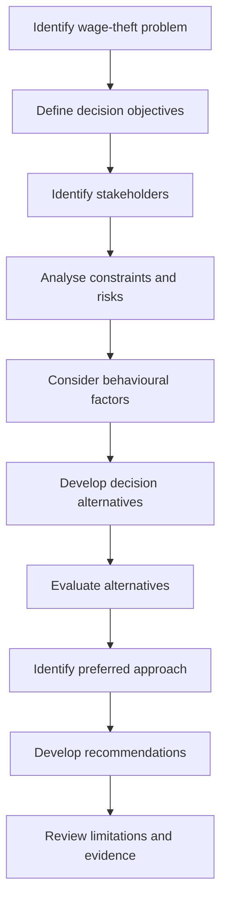
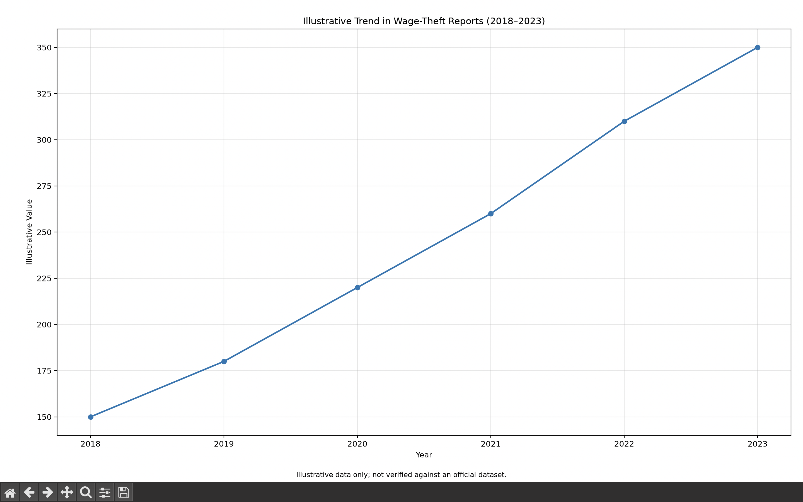
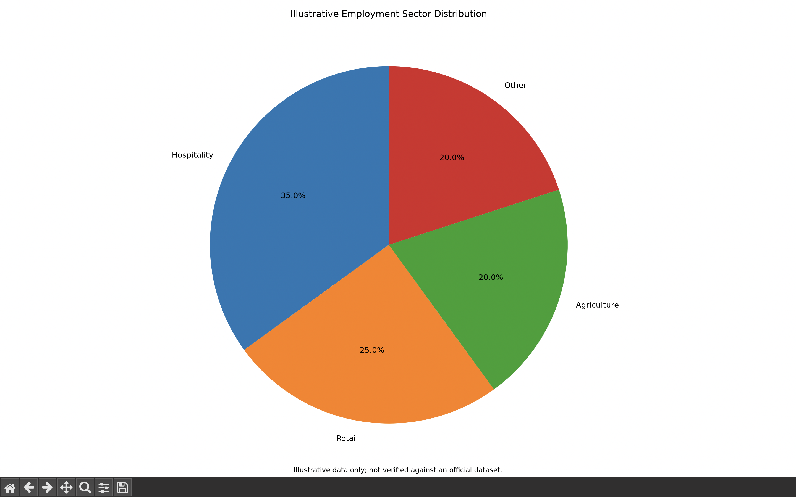
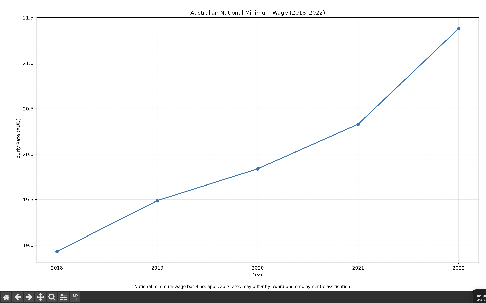

# Decision Analysis: Wage Theft Among International Students in Australia

## Overview

This project examines wage theft affecting international students in Australia through a structured decision-analysis approach. It explores the problem, relevant stakeholders, behavioural and cognitive factors, possible intervention strategies, and the evaluation of alternatives.

The project applies decision-analysis concepts to identify potential responses to wage theft, considering effectiveness, accessibility, feasibility, preventive potential and information capability.

The analysis is based on an academic assignment developed as part of the University of Technology Sydney's Judgment and Decision Making subject and subsequently organised into a portfolio project.

---

## Problem Context

International students in Australia may experience workplace exploitation, including underpayment, unpaid wages, inappropriate deductions, excessive working hours and other unfair employment practices.

Wage theft can be difficult to identify, report and address because of factors such as limited awareness of workplace rights, language barriers, financial dependency, fear of consequences, limited access to support and difficulties navigating reporting systems.

Addressing wage theft therefore requires consideration of multiple stakeholders, institutional responsibilities, enforcement mechanisms and the accessibility of available support systems.

---

## Project Objectives

The objectives of this decision-analysis project are to:

- Examine wage theft affecting international students in Australia.
- Identify relevant stakeholders and their roles.
- Consider behavioural and cognitive factors that may influence decision-making.
- Explore possible intervention strategies.
- Evaluate decision alternatives against multiple criteria.
- Develop a structured approach to identifying a potentially effective intervention.
- Recognise limitations, uncertainty and the need for evidence-based decision-making.

---

## Analytical Scope

This project examines wage theft through the following areas:

- Problem analysis
- Stakeholder analysis
- Behavioural and cognitive considerations
- Decision alternatives
- Evaluation criteria
- Qualitative decision analysis
- Evidence and information availability
- Potential mitigation strategies
- Limitations and recommendations

The analysis focuses on developing and evaluating potential responses rather than claiming to establish the effectiveness of a particular intervention empirically.

---

## Stakeholder Analysis

Addressing wage theft among international students involves several stakeholders with different responsibilities, interests and constraints.

| Stakeholder | Role and relevance |
|---|---|
| International students | Workers potentially affected by underpayment and exploitation |
| Employers | Responsible for complying with employment laws and applicable workplace obligations |
| Fair Work Ombudsman | Provides information, investigates workplace compliance and supports enforcement of workplace laws |
| Australian Government | Establishes regulatory frameworks, policies and institutional arrangements |
| Educational institutions | Can provide information, guidance and support to international students |
| Student associations | Can assist students with awareness, advocacy and access to support |
| Community and legal organisations | May provide advice, assistance and support to workers experiencing exploitation |

Stakeholder coordination is important because wage theft cannot necessarily be addressed through a single intervention or institution.

---

## Behavioural and Cognitive Considerations

Decision-making concerning wage theft may be affected by uncertainty, limited information, perceived risks and behavioural factors.

International students may face circumstances that make reporting or challenging workplace exploitation difficult. These circumstances may influence how individuals assess risks, available choices and potential consequences.

Behavioural considerations relevant to the problem include:

- **Information asymmetry:** Workers may have less information about employment rights, obligations and available reporting mechanisms than employers.
- **Risk perception:** Workers may perceive reporting as potentially threatening to their financial stability, employment relationship or personal circumstances.
- **Decision uncertainty:** Individuals may be uncertain about whether a workplace practice constitutes wage theft and what action they should take.
- **Limited decision resources:** Language barriers, time constraints, financial pressure and access to support may affect the ability to make informed decisions.

These considerations highlight the importance of interventions that reduce uncertainty, improve accessibility and provide reliable information and support.

---

## Decision-Analysis Process

The following conceptual process illustrates the decision-analysis workflow used in this project.



The workflow provides a conceptual structure for organising the analysis. It does not represent an empirically validated intervention model.

---

## Evidence-Based Insight: Data Availability and Enforcement

Data availability and information-sharing capabilities may contribute to the identification and management of workplace compliance issues.

Research discussed in the project's reference materials highlights the relevance of information, data availability and digital regulation in workplace-relations compliance.

Potential considerations include:

- **Information quality:** Reliable and sufficiently detailed information can support the identification of potential compliance issues.
- **Detection capability:** Information may assist regulators and relevant institutions in identifying patterns and prioritising investigations.
- **Institutional coordination:** Appropriate information-sharing arrangements may improve coordination between relevant organisations.
- **Decision support:** Data may support the assessment of risks and the development of targeted interventions.

However, the availability of information alone does not guarantee effective enforcement. Data quality, privacy, institutional capacity, accessibility, governance and implementation constraints must also be considered.

Further details of the research sources are provided in [references.md](references.md).

---

## Decision Alternatives

Five potential intervention alternatives were identified for evaluation.

### A1 — Worker Education

Provide international students with accessible information about workplace rights, pay entitlements, employment conditions and available support.

Potential mechanisms include educational resources, orientation programs, workshops and multilingual information.

### A2 — Reporting and Support Mechanisms

Improve access to reporting channels and support services for workers experiencing suspected wage theft.

Potential mechanisms include accessible reporting processes, confidential advice, assistance services and referral pathways.

### A3 — Targeted Enforcement

Strengthen compliance monitoring and enforcement activities targeting workplaces or sectors where wage theft risks may be elevated.

Potential mechanisms include inspections, investigation activities and enforcement actions.

### A4 — Data Collection and Information Sharing

Improve the collection, analysis and appropriate sharing of information relating to workplace compliance risks.

Potential mechanisms include information systems, reporting data, analytical processes and institutional coordination.

### A5 — Integrated Intervention

Combine education, reporting and support, targeted enforcement, and data collection and information-sharing mechanisms.

The integrated approach aims to address multiple dimensions of the problem rather than relying on a single intervention.

---

## Decision Evaluation Criteria

The alternatives were assessed using five qualitative criteria.

| Criterion | Description |
|---|---|
| Effectiveness | Potential ability to address wage theft and improve workplace compliance |
| Accessibility | Ease with which international students and relevant stakeholders can access the intervention |
| Feasibility | Practical considerations relating to implementation, resources and institutional capacity |
| Preventive Potential | Potential to reduce the likelihood or occurrence of workplace exploitation |
| Information Capability | Potential to improve information availability, identification, monitoring or decision-making |

These criteria were selected to provide a structured basis for comparing the alternatives.

---

## Qualitative Decision Matrix

The following matrix presents a preliminary qualitative assessment of the five alternatives.

| Alternative | Effectiveness | Accessibility | Feasibility | Preventive Potential | Information Capability |
|---|---|---|---|---|---|
| A1 — Worker Education | Medium | High | High | High | Low |
| A2 — Reporting and Support | Medium–High | Medium–High | Medium | Medium | Medium |
| A3 — Targeted Enforcement | High | Medium | Medium–Low | High | Medium |
| A4 — Data Collection and Sharing | Medium–High | Medium | Medium–Low | Medium | High |
| A5 — Integrated Intervention | High (potential) | High (potential) | Medium–Low | High (potential) | High (potential) |

### Matrix Interpretation

The qualitative assessment suggests that an integrated intervention may offer the potential to address several dimensions of wage theft simultaneously.

A1 — Worker Education may provide a relatively accessible and feasible preventive approach, although education alone may not resolve enforcement or employer-compliance issues.

A2 — Reporting and Support may improve access to assistance and reporting pathways, although its effectiveness may depend on accessibility, trust and available resources.

A3 — Targeted Enforcement may offer stronger compliance and deterrence potential, but implementation may require institutional resources and prioritisation.

A4 — Data Collection and Sharing may support monitoring, information availability and decision-making, although practical implementation may involve governance, privacy and coordination challenges.

A5 — Integrated Intervention may combine the strengths of multiple alternatives. However, its potential advantages should not be interpreted as demonstrated effectiveness.

The matrix represents a preliminary qualitative assessment rather than an empirically validated ranking.

---

## Rating Scale and Assessment Method

The qualitative matrix uses a five-level rating scale.

| Rating | Interpretation |
|---|---|
| Very Low | Minimal potential or significant limitations |
| Low | Limited potential |
| Medium | Moderate potential |
| High | Strong potential |
| Very High | Very strong potential |

Intermediate assessments, including Medium–High and Medium–Low, are used where an alternative may fall between two rating levels.

The assessments are qualitative judgements based on the characteristics of the proposed alternatives and the selected evaluation criteria.

No numerical weighting, aggregation or quantitative scoring model was applied in this version of the analysis.

---

## Methodological Transparency

The decision-analysis approach was structured to support transparent comparison of alternatives.

The assessment acknowledges the following methodological considerations:

- Criteria were selected to reflect relevant dimensions of the wage-theft problem.
- Alternatives were assessed qualitatively.
- Ratings represent preliminary judgements rather than measured outcomes.
- The matrix does not establish causal relationships.
- The assessment does not include a validated stakeholder-weighting model.
- No comprehensive cost-benefit analysis was conducted.
- The preferred integrated approach is preliminary and subject to further evidence and validation.

A more advanced analysis could incorporate stakeholder preferences, empirical evidence, implementation costs, weighted criteria, sensitivity analysis and quantitative evaluation.

---

## Visual Analysis

### Visualisation 1 — Reported Wage-Theft Cases (Illustrative)



> **Data limitation:** This visual uses illustrative data to demonstrate trend visualisation and analytical presentation. The values are not verified Australian wage-theft statistics and must not be interpreted as actual reported cases.

This visual demonstrates how a time-series chart may be used to present changes in reported cases over time.

---

### Visualisation 2 — Employment Sector Distribution (Illustrative)



> **Data limitation:** This visual uses illustrative percentages and does not represent verified Australian employment-sector distributions or actual wage-theft prevalence.

This visual demonstrates how categorical data may be presented to compare hypothetical distributions across employment sectors.

---

### Visualisation 3 — Australian National Minimum Wage Trend (2018–2022)



> **Context:** This chart presents the Australian national minimum wage hourly rate over the selected period. National minimum wage rates are a baseline and may not apply to every worker, as award rates, classifications and other employment conditions may affect applicable pay.

This visual demonstrates the presentation of historical wage-rate information in a time-series format.

---

## Limitations of Visual Analysis

The visual analysis has several limitations.

- Visualisations 1 and 2 use illustrative data rather than verified empirical datasets.
- These charts demonstrate analytical presentation techniques and do not establish actual trends or sector distributions.
- The national minimum wage visual provides contextual historical information but does not directly measure wage theft.
- Minimum wage rates alone cannot determine whether a worker has been underpaid, as applicable employment conditions may depend on awards, classifications and other legal requirements.
- The visuals should not be used to establish causal relationships or infer the prevalence of wage theft.

Future development could incorporate verified datasets from government agencies, research organisations and relevant regulatory sources.

---

## Recommendations and Conclusion

The preliminary decision analysis suggests that an integrated intervention may provide a useful conceptual framework for addressing wage theft among international students in Australia.

Combining worker education, accessible reporting and support mechanisms, targeted enforcement, and improved data collection and information-sharing may address different aspects of the problem.

However, the integrated alternative should be regarded as a preliminary recommendation rather than a validated solution.

Further analysis would be required to determine the relative effectiveness, cost, feasibility and stakeholder acceptability of each intervention.

Potential future work includes:

- Incorporating verified empirical data.
- Conducting stakeholder consultations.
- Developing a weighted decision matrix.
- Assessing intervention costs and implementation requirements.
- Conducting sensitivity analysis.
- Evaluating alternative strategies against measurable outcomes.
- Examining privacy, governance and institutional coordination requirements.

This project demonstrates the application of structured decision-analysis principles to a complex social and regulatory problem, highlighting the importance of identifying stakeholders, defining criteria, evaluating alternatives, recognising uncertainty and maintaining methodological transparency.

---

## Repository Structure

```text
wage-theft-international-students/
│
├── README.md
├── references.md
├── data.md
│
└── visuals/
    ├── reported-cases-trend.png
    ├── employment-sector-distribution.png
    └── national-minimum-wage-trend.png
```

### Repository Files

| File | Purpose |
|---|---|
| `README.md` | Project overview, analysis, decision alternatives, evaluation and conclusions |
| `references.md` | References and source materials |
| `data.md` | Data descriptions, limitations and information relating to the project visuals |
| `visuals/` | Visual outputs developed for the portfolio project |

---

## Limitations

This portfolio project has several broader limitations.

- The decision matrix is qualitative and has not been validated using empirical outcomes.
- The ratings are preliminary analytical judgements.
- Stakeholder preferences have not been systematically elicited.
- The project does not provide a comprehensive economic or cost-benefit analysis.
- Illustrative visual data cannot support factual conclusions about actual wage-theft prevalence.
- The analysis does not establish that any intervention will independently or collectively eliminate wage theft.

These limitations should be considered when interpreting the project's recommendations.

---

## Academic Context

This project was originally developed in the context of the Judgment and Decision Making subject at the University of Technology Sydney.

The GitHub portfolio version reorganises and presents the work as a structured decision-analysis project, with an emphasis on analytical transparency, documentation, visual presentation and methodological limitations.

---

*This repository is an academic and portfolio project. It is intended for analytical and educational purposes and does not constitute legal advice or an official assessment of Australian workplace compliance.*
